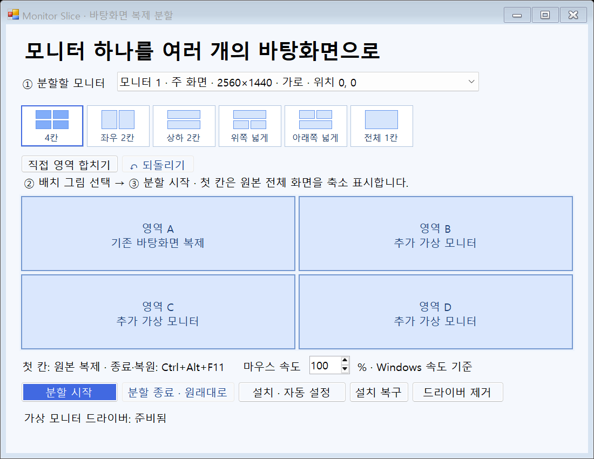

# Monitor Slice

Windows 모니터 하나를 여러 가상 모니터로 나누는 데스크톱 프로그램입니다. 게임이나 프로그램을 따로 등록하지 않고 창을 각 영역으로 옮겨 사용합니다.



## 다운로드와 사용

[최신 릴리스](https://github.com/glasscola/monitor-slice/releases/latest)에서 `MonitorSlice-v1.3.0-win-x64.zip`과 한국어 PDF 설명서를 다운로드하세요.

1. ZIP 전체를 쓰기 가능한 폴더에 압축 해제합니다.
2. `MonitorSlice.exe`를 실행하고 **설치 · 자동 설정**을 누릅니다.
3. Windows 관리자 승인을 허용하고 완료를 기다립니다.
4. 실제 모니터와 배치 그림을 고른 뒤 **분할 시작**을 누릅니다.

종료·긴급 복원: **Ctrl+Alt+F11**. 설치 복구와 앱 소유 가상 모니터 제거도 앱에서 실행합니다.

## 기능

- 모니터 선택, 4칸·좌우·상하·위/아래가 넓은 3칸·전체 1칸
- 이웃 영역을 직사각형으로 합치기와 되돌리기
- 드라이버 설치·독립 장치 4개 구성·복구·제거
- 분할할 모니터의 기존 아이콘·일반 창을 왼쪽 위 칸으로 이동하고 종료 시 원래 배치로 복원
- 다른 물리 모니터의 아이콘·창 위치 유지
- 바탕화면 아이콘 저장·복원과 비정상 종료 후 화면 복구

하나의 Windows를 공유하며 별도 PC나 운영체제를 만드는 방식은 아닙니다. Windows 디스플레이 설정에는 실제·가상 모니터가 함께 표시됩니다.

기존 아이콘을 첫 칸에 겹치지 않게 배치할 공간이 부족하면 분할을 취소하고 복원합니다. 이 경우 첫 칸이 넓은 배치를 고르세요. 일반 표시 창이 대상이며, 최소화된 창·관리자 권한 창·자체 위치를 강제하는 앱은 이동 동작이 다를 수 있습니다. 실행 중 직접 옮긴 기존 창도 종료 시 저장한 위치로 복원됩니다.

## 지원 환경과 설치 기록

Windows 11 x64에서 검증했습니다. 드라이버 작업에는 관리자 승인이 필요합니다. 환경에 따라 설치가 수분 걸리거나 재시작이 필요할 수 있습니다. 실행 중 모니터 분리·배율 변경 등 모든 환경을 검증한 것은 아닙니다.

새 설치 기록과 드라이버 설정: `%ProgramData%\MonitorSlice`. 화면·아이콘 복구 정보: 실행 폴더의 `data`. 복구가 끝나기 전에 `data`를 삭제하지 마세요.

이전 이름의 버전에서 설치한 PC는 설치 버튼을 누르면 기존 소유 장치 기록을 인식해 새 경로로 전환합니다. 제3자 가상 디스플레이 설정을 임의로 가져오지는 않습니다. 이전 복구 기록이 있는 경우 기존 폴더에서 복구를 먼저 완료하세요.

## 빌드

Windows용 Visual Studio C++ Build Tools(C++20, Windows SDK)와 .NET Framework 4.x C# 컴파일러가 필요합니다.

```powershell
.\native\Build.cmd
.\Build.ps1
.\Package.ps1
```

네이티브 DLL은 정적 C++ 런타임으로 빌드합니다. `Package.ps1`은 실행 파일·필수 DLL·서명된 드라이버·라이선스·안내문·PDF만 묶습니다. `data`와 `evidence`는 배포하거나 커밋하지 않습니다.

## 검사

```powershell
.\MonitorSlice.exe --carry-test
.\MonitorSlice.exe --mode-check
.\MonitorSlice.exe --virtual-test --full
```

통합 검사는 실제 모니터 구성과 포커스를 잠시 바꾸고 복원합니다. 작업 중 실행하지 마세요. 결과는 `evidence`에 저장됩니다. `--setup-cycle-test`는 앱 소유 드라이버를 제거·재설치하는 개발용 검사입니다.

## 제3자 구성요소

[Virtual Display Driver](https://github.com/VirtualDrivers/Virtual-Display-Driver), MttVDD 11.30.4.434. 공식 서명된 INF/DLL/CAT 파일은 이름과 내용을 변경하지 않습니다. MIT 라이선스 고지는 [driver/LICENSE.txt](driver/LICENSE.txt)에 포함되어 있습니다.
